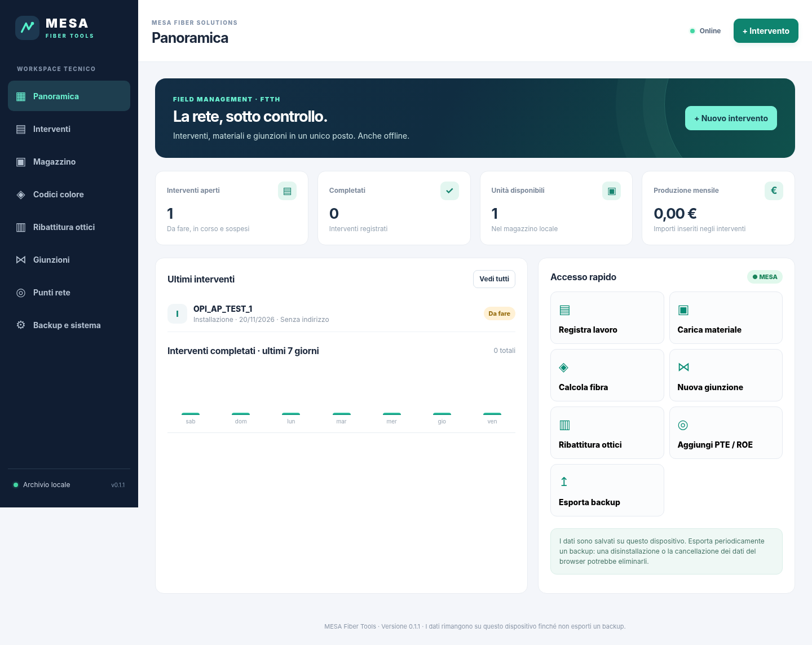

# MESA Fiber Tools — versione iniziale 0.1.1

Una **PWA indipendente**, gratuita e senza framework, pensata per le operazioni FTTH sul campo. Il codice di questa applicazione è stato scritto da zero per MESA Fiber Solutions. Non utilizza né incorpora il codice di `napoltano/fiber-tools`.

## Anteprime



[Anteprima su smartphone](docs/preview-mobile.png)

## Funzioni pronte

- Dashboard: interventi aperti/completati, unità a magazzino, importi mensili e grafico ultimi 7 giorni.
- Interventi: codice ordine/OPI_AP, data, stato, operatore, tecnico, PTE/ROE, produzione e note. Creazione, modifica, eliminazione, ricerca, filtro ed export CSV.
- Magazzino: materiale, SKU, seriale, quantità, stato, operatore, ordine associato. Controllo duplicati seriali, filtro ed export CSV.
- Colori: calcolo fibra/tubetto secondo la **sequenza base TIA-598**, capacità 6/12/24/36 fibre/tubetto, tabella fino a 144 fibre.
- Ribattitura ottici: schede PFS/splitter da 16 porte, ID e permute, segnalazione duplicati, CSV.
- Giunzioni: collegamento progressivo N−/N+, schemi salvati e stampa/PDF del riepilogo, export CSV.
- Punti rete: PTE, ROE, PFS, PFP, POP, PD, muffola. GPS, coordinate, elenco, indicazioni Google Maps, export GeoJSON. Mappa Leaflet/OpenStreetMap online.
- Offline: *interventi, magazzino, calcolatore, giunzioni ed elenco punti* sono accessibili senza rete **dopo il primo caricamento online**.
- Backup completo dei dati in JSON e ripristino manuale.

**Limiti attuali:** non è ancora presente autenticazione, sincronizzazione tra dispositivi, Google Sheets, scanner barcode/camera, foto GPS, importazione KML, sincronizzazione ribattiture, gestione permute Open Fiber o algoritmi FiberCop. La mappa con tasselli richiede internet; i dati locali no. Gli importi della dashboard sono valori inseriti, non fatture.

## Avvio locale

Servono Python 3 oppure un semplice web server HTTP. Non aprire `index.html` con `file://`, perché la PWA usa moduli JavaScript e IndexedDB.

```sh
cd MESA_Fiber_Tools
python3 -m http.server 8080
```

Apri http://localhost:8080 in Chrome. Per eseguire i test:

```sh
node --test tests/*.test.mjs
```

## Pubblicazione gratuita su GitHub Pages

1. Crea un repository **nuovo e indipendente**, ad esempio `mesa-fiber-tools`. **Non effettuare un fork del repository originale** senza aver verificato la relativa licenza/autorizzazione.
2. Copia il **contenuto di questa cartella** nella radice del repository. Il ramo di default deve essere `main`.
3. In **Settings → Pages**, imposta come Source **GitHub Actions**.
4. Apri **Actions → Pubblica MESA Fiber Tools → Run workflow**, oppure carica/effettua commit dei file sul ramo `main`. Il deploy avviene solo dopo che i test automatici sono passati.
5. La pagina sarà di norma `https://TUO-UTENTE.github.io/mesa-fiber-tools/` (l'indirizzo preciso appare nel job di deploy). Aprila da Chrome Android → menu **Aggiungi a schermata Home / Installa app**.

In questo modo ogni push sul ramo `main` pubblica automaticamente MESA. Non è necessario comprare hosting per il prototipo. Ricorda che **GitHub Pages pubblica i file statici**: non è indicato per mettere credenziali, informazioni segrete o documenti riservati nel codice/repository.

## Aggiornamenti MESA e monitoraggio progetto originale

La cartella `.github/workflows/` contiene due flussi separati:

- `pages.yml`: pubblica **il tuo codice MESA** a ogni push su `main`.
- `upstream-watch.yml`: controlla i commit sul ramo `main`, gli eventuali tag e le release pubblicate su `napoltano/fiber-tools`. Al primo avvio salva una issue di riferimento (chiusa); quando qualcosa cambia, crea un'**issue aperta** con i link. Non modifica il codice MESA. Richiede le **Issues** abilitate sul repository MESA e che GitHub Actions abbia il permesso di creare issue. Può anche essere lanciato manualmente dalla scheda Actions. Se GitHub non consente la creazione di issue, verifica **Settings → Actions → General → Workflow permissions**.

Il monitoraggio **non integra automaticamente il codice originale**: il repository esterno non contiene una licenza verificata che ne consenta il riuso. Le nuove funzionalità andranno sviluppate in modo autonomo o integrate solo dopo aver ricevuto licenza/autorizzazione, quindi testate.

Per pubblicare una release MESA:

1. Modifica e testa il codice.
2. Aggiorna `APP_VERSION` in `core.mjs`, `CACHE_VERSION` in `sw.js`, la versione in `package.json` e `CHANGELOG.md`.
3. Esegui `node --test tests/*.test.mjs`.
4. Esegui commit e push su `main`.
5. Dopo la pubblicazione, alla riapertura della PWA il service worker scaricherà la nuova shell e lascerà intatti i dati IndexedDB. Puoi verificare manualmente con **Backup e sistema → Controlla aggiornamenti**.

**Attenzione:** i dati sono salvati in **IndexedDB sul singolo browser/dispositivo**. Aggiornare la PWA non dovrebbe cancellarli, ma cancellare dati del sito, disinstallare con eliminazione dati o cambiare dominio può farli perdere. Esegui regolarmente il backup JSON e conservalo al sicuro. Un file di backup può contenere nomi/indirizzi/seriali: non pubblicarlo su GitHub.

## Sicurezza e precisione tecnica

- Gli input mostrati nelle schermate vengono sottoposti a escape HTML, così i valori dell'utente non possono diventare markup eseguibile.
- L'export CSV protegge le celle che potrebbero essere interpretate come formule dal foglio elettronico.
- La mappa utilizza servizi terzi Leaflet (libreria) e OpenStreetMap (tasselli); quando la mappa è aperta vengono richiesti dati a quei servizi.
- La tavola TIA-598 serve per la **convenzione base**. Fibra per tubetto, ripetizioni con marcature e convenzioni dei committenti vanno sempre verificati con i documenti di rete. La pianificazione delle giunzioni non effettua collaudi né controlli di saturazione.
- Non inserire dati sensibili su dispositivi condivisi: IndexedDB non è cifrato dall'app.

## File importanti

- `index.html`: interfaccia base e navigazione
- `app.css`: interfaccia responsiva
- `app.mjs`: logica delle schermate
- `core.mjs`: funzioni di calcolo pure, testabili
- `storage.mjs`: database locale IndexedDB
- `sw.js`: service worker offline e cache versionata
- `manifest.webmanifest` e `icons/`: installazione PWA
- `tests/`: test automatici core
- `.github/workflows/`: deploy e rilevamento nuove versioni upstream

## Stato della verifica della versione 0.1.1

- `npm test`: 8/8 test superati.
- Test interattivo su Chromium con archivio simulato: salvataggio di interventi, materiali, ribattiture ottiche (16 porte), punti rete e schemi di giunzione superato.
- La verifica è limitata: non sostituisce un collaudo end-to-end con IndexedDB reale, installazione PWA da HTTPS, GPS o caricamento delle mappe online.
- **La pubblicazione su GitHub richiede un repository esistente e autorizzazioni di scrittura**, e GitHub Pages va abilitato dalle impostazioni del repository.
